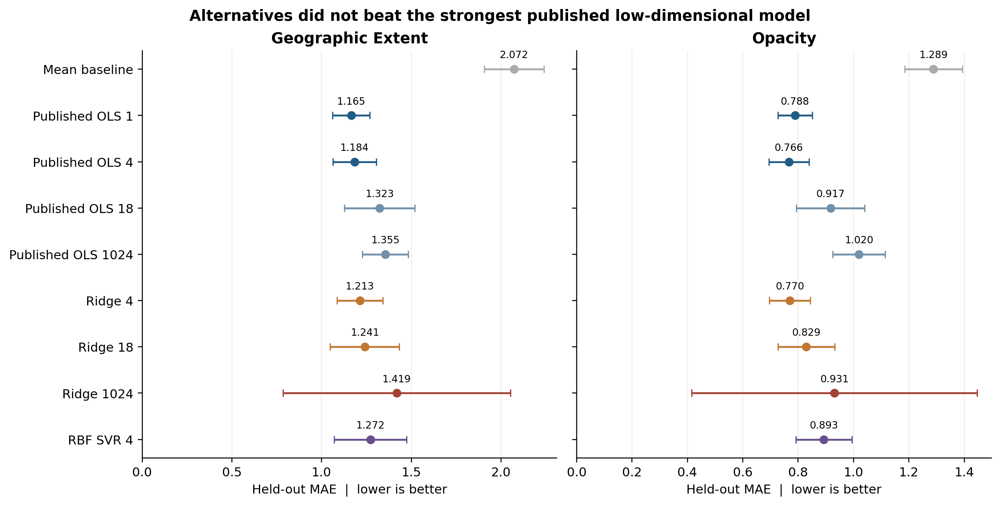
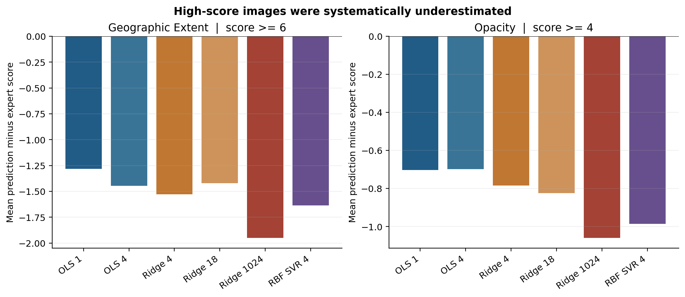

# DSA5206

COVID-19 chest X-ray severity prediction: Part II critical assessment and an executed alternative-model comparison.

## 成果入口

- [英文报告与中文说明 PDF](reports/DSA5206_PartII_Report.pdf)
- [可编辑 Word 报告](reports/DSA5206_PartII_Report.docx)
- [分析 notebook](PartII_Analysis.ipynb)
- [课堂 12 项 checklist](checklist.csv)
- [全部模型汇总结果](results/summary.csv)
- [逐张测试预测](results/test_predictions.csv)
- [轻量实验包 ZIP](downloads/DSA5206_PartII_Experiment.zip)

本仓库保存了实际使用的 94 张公开胸片（cache/images）、评分、冻结特征、50 次患者分组划分、完整实验结果和图表。预训练模型权重按原作者链接下载，不在仓库内重复存放。

**主要结论：** 在相同患者分组测试与训练内选参下，所测试的 Ridge 和 RBF SVR 没有超过原论文最佳低维 OLS 配置。Geographic Extent 最低 MAE 为 1.165；Opacity 为 0.766。保留了标准化高维 Ridge 的失败案例。





原 GitHub Project 地址：https://github.com/users/ModaYoung/projects/1

## Detailed methods and reproducibility

The report applies the 12 questions in Lecture 9, page 11 (elaborated on pages 14-21). It evaluates Cohen et al., Cureus 2020, DOI 10.7759/cureus.9448. It does not substitute CLAIM or a different checklist for the classroom framework.

## Contents

- `PartII_Analysis.ipynb`: executed analysis notebook, with optional refitting.
- `checklist.csv`: all 12 classroom questions with evidence, critical judgments, recommendations and Chinese explanations.
- `data/`: 94-image cohort, original severity label file, cached frozen features, image hashes and source provenance.
- `results/`: all 900 outer-fit metrics, held-out predictions, patient split manifests, selected hyperparameters, summary tables and figures.
- `code/`: download and feature extraction, grouped nested comparison, figure generation, result verification and the numerical failure diagnostic.

## Read the results first

No tested alternative beat the strongest published low-dimensional OLS configuration on mean held-out MAE. Geographic Extent: OLS 1 = 1.165; Opacity: OLS 4 = 0.766. Ridge 4 = 1.213 and 0.770, respectively. These are newly run results, not copied from the paper or the group's notebook. See the report for uncertainty and scope.

The standardized Ridge 1024 pipeline produced an extreme out-of-range prediction in split 27. We retained it. `failure_diagnostic.json` records a check using a second solver. A nearly constant training feature was amplified by scaling. This is a failure of this tested pipeline, not evidence that every regularized high-dimensional model fails.

## Reproduce the comparison from cached features

Use Python 3.12. The recorded run used 3.12.14 on Windows and CPU inference. In a fresh environment:

```text
python -m pip install -r requirements-analysis.txt
python code/verify_results.py
python code/run_comparison.py
python code/make_figures.py
```

Alternatively open `PartII_Analysis.ipynb` and use its existing results. Set `RERUN=True` to refit all models. The cached features make this step independent of downloading chest radiographs or installing PyTorch. Install an appropriate Jupyter environment if needed.

## Re-extract features from the fixed public images

This step downloads approximately 35 MB of original images plus model weights into `cache/`. Raw images and weights are intentionally excluded from this archive; source access and image terms still apply.

```text
python -m pip install -r requirements-images.txt
python code/prepare_features.py
python code/run_comparison.py
python code/make_figures.py
python code/verify_results.py
```

CPU-only PyTorch wheels can instead be installed using the official PyTorch CPU index before the remaining requirements. The prepared features and source checksums correspond to `data/provenance.json`.

## Protocol

- Same 94 scored PA images, 65 patients, fixed source commit `196143d3dd32a2a43ad51d6891d460aaf690d741` (2020-03-30).
- Frozen DenseNet 121, pre-sigmoid outputs and pooled 1024-dimensional features.
- Two expert-score targets; 9 models; 50 patient-grouped 50/50 splits with seeds 0-49.
- Ridge and RBF SVR: training-only 5-fold GroupKFold grid search, optimized for MAE. Scaling is inside the pipeline.
- Main alternative: Ridge 1024. Additional Ridge 4, Ridge 18 and RBF SVR 4 comparisons are secondary.
- Predictions are not clipped. Every failure remains in the metrics.
- Mean plus/minus SD summarizes dependent repeated splits; SD is not a 95 percent confidence interval.
- Patient bootstrap intervals are descriptive and conditional on saved out-of-sample predictions. They do not rerun training or establish independent external superiority.
- High-score cutoffs (extent >=6, opacity >=4) are exploratory radiographic strata, not validated clinical categories.

## Provenance and attribution

1. Cohen JP et al. Predicting COVID-19 Pneumonia Severity on Chest X-ray With Deep Learning. Cureus 2020;12:e9448. https://doi.org/10.7759/cureus.9448
2. Zhang Louxin. DSA5206 Lecture 9, Assessment of AI Studies in Medicine, 2026, pp. 11 and 14-21. Course checklist is reproduced for coursework assessment.
3. Original resources: https://github.com/mlmed/covid-severity and https://github.com/mlmed/torchxrayvision
4. Image metadata snapshot: https://github.com/ieee8023/covid-chestxray-dataset/tree/196143d3dd32a2a43ad51d6891d460aaf690d741
5. Existing group reproduction: https://github.com/apothecary11/DSA5206-GROUP-PROJECT (reviewed commit f2127e6b8f0ae84eef618a308adb657be0cb65c0).

The severity CSV retains its original CC BY-SA attribution header. Observe the original terms of the images, metadata, labels and model resources when reusing them. This package does not claim ownership of those source materials.

## 中文使用说明

先阅读 Word 或 PDF 中的英文正文和中文附录。checklist 严格对应第 9 讲的 12 个问题。实验已实际运行，结果为替代方法未超过原论文最好的低维模型；负结果同样完整回答作业要求。

若只需要复跑对比，安装 requirements-analysis.txt 后运行 code/run_comparison.py 即可，无需下载胸片或安装 PyTorch。data 中缓存了特征；results 中保存了全部预测、参数和划分，便于核查或制作 PPT。不要把本次新运行数值、原论文数值和旧 notebook 数值混成一组结果。
