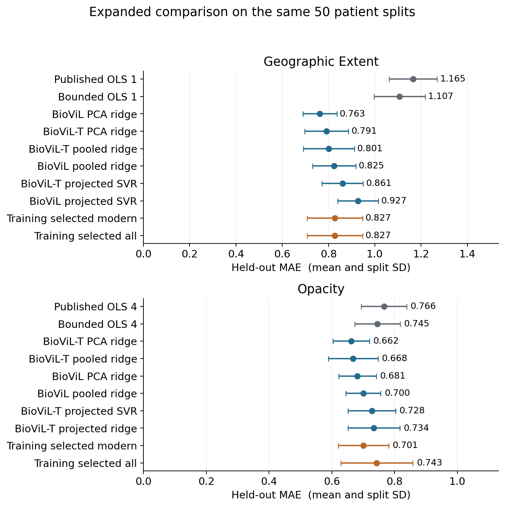
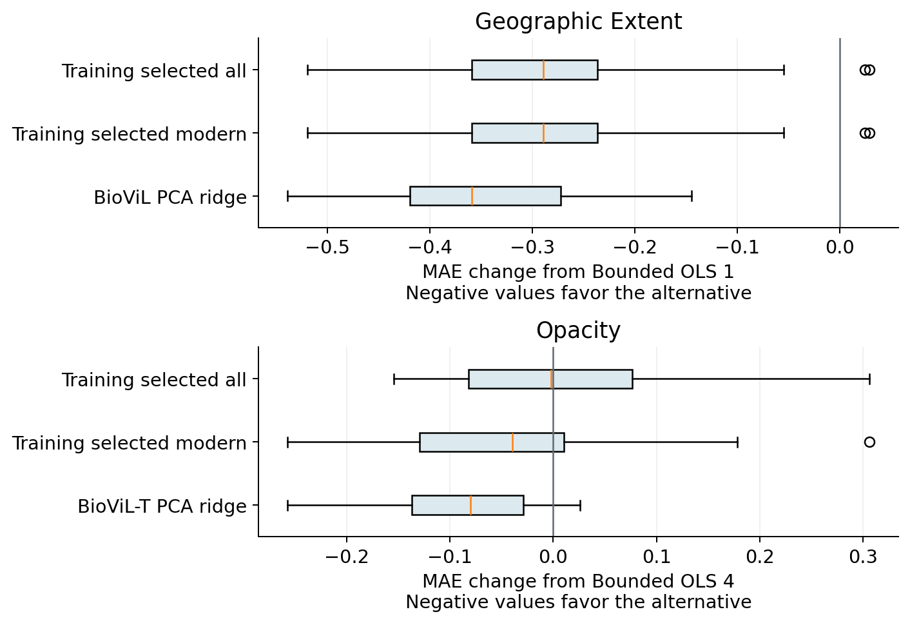
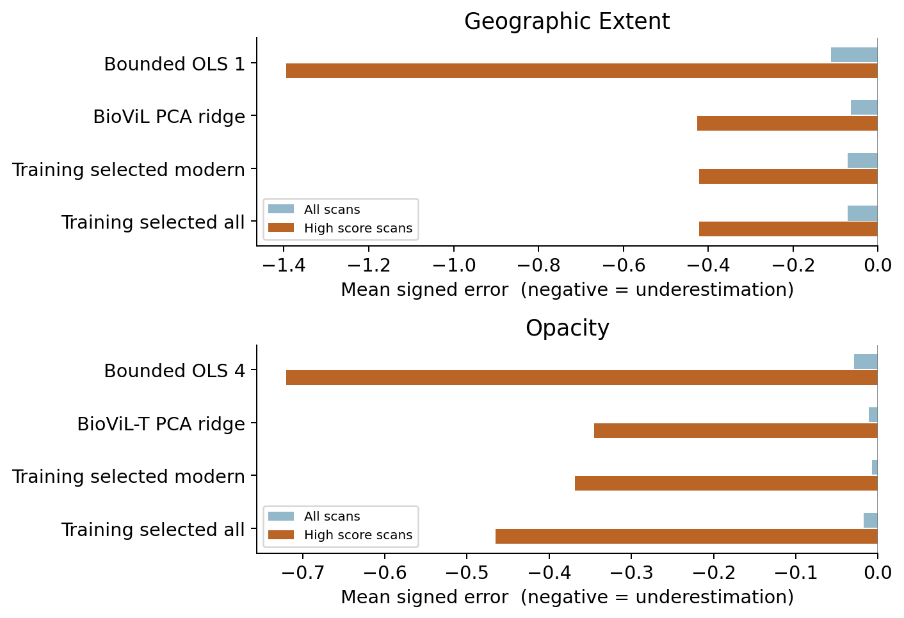

# DSA5206

COVID-19 chest radiograph severity prediction. Part II applies the 12 classroom checklist questions and compares the paper method with alternative regressors and newer image encoders.

## 成果入口

- [更新后的报告 PDF](reports/DSA5206_PartII_Report.pdf) · [可编辑 Word](reports/DSA5206_PartII_Report.docx)
- [中文分析说明](PartII_说明与分析.md)
- [已执行的分析 notebook](PartII_Analysis.ipynb)
- [课堂 12 项 checklist](checklist.csv)
- [完整扩展排行榜](results/expanded/all_models_summary.csv)
- [配对比较](results/expanded/paired_comparisons.csv) · [五折敏感性分析](results/expanded/fivefold_pooled_summary.csv)
- [全部主实验测试预测](results/expanded/half/test_predictions.csv)
- [实验包 ZIP](downloads/DSA5206_PartII_Experiment.zip)

## 这次补充了什么

在原 DenseNet 特征之外，实际提取了 BioViL、BioViL-T、RAD-DINO 三种公开编码器特征。新增 27 组配置，连同初始 9 组，共 36 组实际模型配置；使用相同 50 次患者分组划分，并补做五折患者分组敏感性分析。合计 **3,870 次外层拟合**，内层调参拟合另计。三种选模程序复用候选预测，不算额外拟合。

病变范围：BioViL PCA ridge：0.763；相对 Bounded OLS 1 的 1.107，MAE 降低 31.1%。

浑浊程度：BioViL-T PCA ridge：0.662；相对 Bounded OLS 4 的 0.745，MAE 降低 11.2%。

| 方法 | Extent MAE | Opacity MAE |
|---|---:|---:|
| 原方法重新运行 | 1.165 ± 0.104 | 0.766 ± 0.072 |
| 原方法加相同分数约束 | 1.107 ± 0.110 | 0.745 ± 0.072 |
| 观察到的最佳现代模型配置 | 0.763 ± 0.073 | 0.662 ± 0.058 |
| Training selected OLS | 1.127 ± 0.107 | 0.766 ± 0.071 |
| Training selected modern | 0.827 ± 0.120 | 0.701 ± 0.080 |
| Training selected all | 0.827 ± 0.120 | 0.743 ± 0.115 |

表中为 50 次划分的均值 ± SD，MAE 越小越好。SD 不是置信区间。观察到的最佳现代配置分别为 **BioViL PCA ridge** 与 **BioViL-T PCA ridge**。排行榜上的最佳结果属于探索性结果；训练内选模程序则只凭各外层训练集的五折验证决定用哪个方法。







## How the comparison was run

- The cohort remains 94 scored PA images from 65 patients at source commit `196143d3dd32a2a43ad51d6891d460aaf690d741`.
- All encoders are frozen. This is downstream transfer using released checkpoints, not a reproduction of their full pretraining papers. BioViL-T uses the current image only.
- The main extension reuses the original 50 patient-grouped half splits. Hyperparameters, scaling, filtering and PCA are learned inside five grouped training folds.
- New pipelines use the known score bounds during validation and testing. Bounded OLS is included to distinguish clipping gains from changes of encoder. Raw predictions are retained. The initial unbounded outputs are unchanged.
- Training selected OLS chooses OLS 1 or OLS 4; Training selected modern chooses among 12 new-encoder pipelines; Training selected all chooses among the 27 new configurations. Family selection uses inner CV MAE, never the outer test MAE.
- Fivefold outer CV holds every patient out once, and its pooled MAE is a sensitivity analysis at a larger training size.
- This extension was designed after seeing the initial experiment. All conclusions remain exploratory and internal. Repeated splits are dependent. Conditional patient bootstrap intervals do not include retraining uncertainty.

The previous standardized Ridge 1024 failure is retained in the initial results. Its diagnosis motivated training-only variance filtering, alternative scaling and PCA. The repair is identified as a post-initial exploratory sensitivity, not silently substituted for the original result.

## Reproduce or inspect

Python 3.12 was used. Cached features permit a complete regression rerun without downloading encoders:

```text
python -m pip install -r requirements-analysis.txt
python code/verify_results.py
python code/verify_extended.py
python code/run_extended_comparison.py
python code/run_extended_comparison.py --scheme fivefold
python code/summarize_extended.py
```

To re-extract the original and modern features:

```text
python -m pip install -r requirements-images.txt
python code/prepare_features.py
python code/prepare_extended_features.py
```

Raw images are in `cache/images`; weights are downloaded to `cache/weights` and are not redistributed. The ZIP omits raw images and weights to keep it smaller. Every model revision, preprocessing rule and weight/feature hash is recorded in `data/extended_feature_provenance.json`. Exact software versions are in `results/expanded/environment.json`.

## Files and interpretation

- `results/summary.csv` and the adjacent original outputs preserve the first 900 fits.
- `results/expanded/all_models_summary.csv` includes all initial and new configurations plus selection procedures.
- `results/expanded/half` contains 50-split metrics, predictions, split indices and family choices.
- `results/expanded/fivefold` contains the corresponding fivefold outputs.
- `results/expanded/selected_hyperparameters.csv` and `fit_details.jsonl.gz` preserve inner scores, parameters and warnings.
- `results/expanded/protocol.json` and `protocol_lock.json` record the extension specification before its outcomes were inspected.
- `results/expanded/verification.json` and `validation_log.txt` record counts and independent result checks.
- `results/expanded/figures` contains five standalone figures for the report or slides.

No test split, bad prediction or unsuccessful model was dropped. We highlight the better results in the report while retaining the complete comparison. Scores refer to expert radiographic severity, not clinical diagnosis or patient outcomes.

## Sources and attribution

1. Cohen JP et al. Cureus 2020;12:e9448. https://doi.org/10.7759/cureus.9448
2. DSA5206 Lecture 9, p. 11 and pp. 14-21. Course PDFs are not redistributed.
3. Original model resources: https://github.com/mlmed/covid-severity and https://github.com/mlmed/torchxrayvision
4. Dataset snapshot: https://github.com/ieee8023/covid-chestxray-dataset/tree/196143d3dd32a2a43ad51d6891d460aaf690d741
5. BioViL, ECCV 2022: https://arxiv.org/abs/2204.09817
6. BioViL-T, CVPR 2023: https://arxiv.org/abs/2301.04558
7. RAD-DINO, preprint 2024 and journal 2025: https://doi.org/10.1038/s42256-024-00965-w
8. Public RAD-DINO checkpoint: https://huggingface.co/microsoft/rad-dino
9. Group reproduction reviewed at `f2127e6b8f0ae84eef618a308adb657be0cb65c0`: https://github.com/apothecary11/DSA5206-GROUP-PROJECT

See DATA_ATTRIBUTION.md for image and label attribution. The public RAD-DINO checkpoint differs from its paper checkpoint. Public encoder pretraining sources are documented, but no exhaustive pixel-level pretraining-membership audit has been performed.
